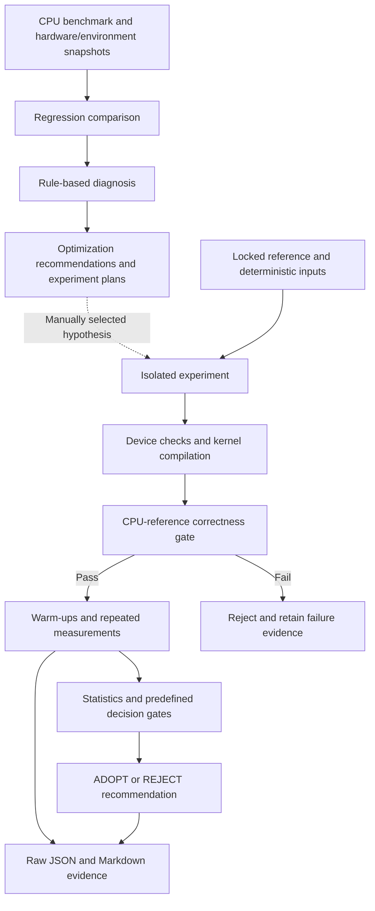

# ROCm Performance Guard

Evidence-driven performance regression analysis and controlled GEMM optimization.

ROCm Performance Guard records benchmark results, checks whether comparisons are valid, investigates hardware and software changes, and evaluates optimization candidates against explicit acceptance rules. It combines a Python analysis toolkit with isolated CPU and GPU experiments whose raw measurements remain available for review.

**Current status:** Experiment 7 is the retained GPU configuration: an 8×8 tiled, column-first OpenCL FP32 GEMM on AMD Radeon `gfx90c`. Experiment 8 rejected explicit inner-loop unrolling. Native ROCm/HIP GEMM execution is not implemented; the validated AMD GPU path is **native Windows OpenCL**.

## Why performance needs a guard

A lower timing number is not automatically an improvement. Background activity, warm-up effects, changed inputs, different hardware, numerical errors and measurement boundaries can all invalidate a comparison. An optimization can also reduce median latency while worsening tail latency.

This project makes those checks part of the experiment: preserve a reference, change one dimension, validate correctness, retain raw timings, and adopt only candidates that meet predefined gates. Rejected hypotheses are useful results.

## Key features

- Deterministic GEMM inputs and a pure-Python CPU benchmark with configurable dimensions, warm-ups, measurement counts and worker count.
- Hardware/environment snapshots and capability inspection, including WSL and runtime/tool availability.
- Benchmark comparison with configuration checks, configurable thresholds and insufficient-evidence handling.
- Rule-based regression diagnosis, ranked optimization recommendations and experiment planning. These are recommendations, not automatic system changes or proven causal diagnoses.
- Isolated native Windows AMD OpenCL GEMM experiments using `ctypes` and runtime kernel compilation.
- CPU-reference correctness checks, finite-value rejection, completed-event GPU profiling, separate transfer timings and raw JSON evidence.
- Explicit adoption/rejection decisions, source/input hashes and preservation checks for historical experiments.
- Standard-library `unittest` coverage for analysis, correctness, timing, configuration legality and decision logic.

## How it works

The reusable analysis modules in `src/` compare benchmark records and hardware/environment snapshots. The OpenCL experiments are standalone scripts; they are not registered as an OpenCL backend in the generic CPU benchmark CLI.



The GPU implementation layers reuse existing code: Experiment 5 provides OpenCL allocation, dispatch and event timing; Experiment 6 adds local-memory tiling and legality checks; Experiment 7 changes work-item mapping; Experiment 8 varies only the inner-loop unroll factor. Experiment 8's control uses the exact Experiment 7 kernel and measurement routine.

### GPU correctness and measurement protocol

For Experiments 5–8, the workload is `C = A × B`, with `M = N = K = 512` and FP32 inputs/output.

- Inputs come from the deterministic generator in `src/benchmark.py`, rounded to FP32.
- The GPU CPU-reference calculation uses `math.fsum` over products of the same FP32 input values, then rounds the output to FP32.
- Every output must be finite and satisfy `abs(GPU - CPU) <= 0.001 + 0.001 * abs(CPU)`.
- Reports include maximum/mean absolute error and maximum/mean relative error. Relative error uses `max(abs(CPU), 1e-12)` as its denominator.
- Each configuration uses **10 warm-ups, 50 measured iterations and 3 independent runs**, with a fresh process/context per run. Correctness is checked before measurement and after warm-ups and measured iterations.
- The in-order command queue enables profiling. The host waits for the final read event before reading kernel START/END timestamps. Kernel latency is the primary metric.
- H2D, D2H and synchronized end-to-end latency are separate fields. End-to-end timing excludes setup, compilation, reference generation and correctness checking.
- GPU summaries pool 150 kernel measurements per configuration and report median, mean, P95, min, max and GFLOPS. Run variability is the sample standard deviation of the three run medians divided by their mean.

```text
GFLOPS = (2 × M × N × K) / kernel_latency_seconds / 1e9
speedup = reference_median / candidate_median
latency_reduction_percent = (reference_median - candidate_median) / reference_median × 100
```

The later GPU adoption gates require correctness, a complete matching protocol, at least 5% median improvement, improvement exceeding the variability margin, a P95 guard and improvement across all run medians. Experiments 7–8 also require a reproducible fresh control and improvement against both that control and the locked reference. These are conservative heuristics, not formal statistical-significance tests.

## Repository structure

```text
README.md
src/
  benchmark.py              CPU benchmark, deterministic inputs and result persistence
  hardware.py               Hardware inspection
  environment.py            Software/environment snapshots
  capabilities.py           Runtime and device-interface inspection
  regression.py             Benchmark comparability and regression classification
  diagnosis.py              Evidence-based change analysis
  optimizer.py              Ranked optimization recommendations
  experiment.py             Controlled experiment plans
  verification.py           Candidate improvement verification
  transpose_experiment.py   Historical CPU layout experiment
  parallel_experiment.py    Historical CPU worker-count experiment
experiments/
  EXPERIMENT_PROTOCOL.md     Historical CPU experiment protocol
  README.md                 Earlier CPU benchmark documentation
  run_experiments.py        Historical CPU measurement/tiling runner
  gpu_correctness.py        Separate RTX 2050 correctness check
  opencl_gemm_baseline.py   Experiment 5: native Windows OpenCL baseline
  opencl_gemm_tiling.py     Experiment 6: local-memory tiling
  opencl_gemm_mapping.py    Experiment 7: retained column-first mapping
  opencl_gemm_unrolling.py  Experiment 8: rejected unrolling candidates
  results/                 Locked baseline, plans, raw runs, summaries and reports
tests/                     unittest suites
```

The earlier experiment documentation describes the CPU phase. Use the GPU reports and the protocol above for Experiments 5–8; their timing method and iteration counts differ from the CPU defaults.

## Experiments and measured results

### CPU foundation and separate NVIDIA observation

The CPU evidence was recorded on an AMD Ryzen 7 7730U under Ubuntu 24.04.5 LTS in WSL2. The locked CPU median is **1342.067 ms**, using 5 warm-ups and 30 measurements. Experiments 0, 2 and 3 record three independent runs; Experiment 1 records 30 measurements per tile size.

| Experiment | Recorded outcome | Evidence |
|---|---|---|
| 0 — measurement validation | Run-median CV 0.96%; judged stable by the recorded rule | [Measurement validation](experiments/results/experiment_001/experiment_000_measurement_validation.json) |
| 1 — CPU loop tiling | Best tested tile 128: 1492.932 ms; all tested sizes regressed against the locked reference | [Summary](experiments/results/experiment_001/experiment_001_summary.json) |
| 2 — pre-transposed B | 7186.722 ms steady-state median; REJECT | [Summary](experiments/results/experiment_002/experiment_002_summary.json) |
| 3 — CPU parallelism | Best tested configuration: 8 workers, 1397.077 ms; REJECT against the locked baseline | [Summary](experiments/results/experiment_003/experiment_003_summary.json) |
| 4 — RTX 2050 correctness | User-supplied PASS observation; local re-execution was unavailable | [Provenance and limitations](experiments/results/experiment_004/experiment_004_report.md) |

The CPU backend uses Python floating-point arithmetic despite the historical `fp32` configuration label. Its arithmetic and timing scope differ from the OpenCL kernel, so these tables do not establish a CPU-to-GPU speedup. Experiment 2 also compares a single-worker candidate against a multi-worker baseline that already transposes B; it does not isolate the causal effect of transposition. Experiment 4 is NVIDIA evidence, not AMD or ROCm validation.

### Validated AMD OpenCL branch

Measured on the Ryzen 7 7730U integrated AMD Radeon `gfx90c`, native Windows 11, Python 3.13.13, AMD Accelerated Parallel Processing platform, OpenCL device version 2.0 and driver `3444.0 (PAL,HSAIL)`. Values below are measured kernel timings, not theoretical throughput.

| Experiment | Configuration | Median kernel ms | GFLOPS | Run-median CV | Conclusion |
|---|---|---:|---:|---:|---|
| 5 | Untiled OpenCL baseline | 13.71730 | 19.5691 | 4.12% | Locked starting reference |
| 6 | 8×8 local-memory tiling | 6.13649 | 43.7441 | 0.40% | ADOPT; 55.26% reduction vs E5 |
| 7 | 8×8 tiling + column-first mapping | 3.71454 | 72.2661 | 0.22% | ADOPT; 39.47% reduction vs E6; retained |
| 8 | Explicit unrolling ×2, ×4, ×8 | See below | See below | See below | All REJECT; retain E7 |

Experiment 6 also measured legal 16×16 tiling at 10.53510 ms; it passed the E5 improvement gate but was slower than 8×8. The 32×32 configuration was unsupported and not benchmarked.

Reports and raw run files are preserved together:
[Experiment 5](experiments/results/experiment_005/experiment_005_20261003_145248_372949_report.md),
[Experiment 6](experiments/results/experiment_006/experiment_006_20261003_161254_144008_report.md),
[Experiment 7](experiments/results/experiment_007/experiment_007_20261003_165754_114432_report.md),
[Experiment 8](experiments/results/experiment_008/experiment_008_20261003_171954_340824_report.md).

### Experiment 8: why unrolling was rejected

The hypothesis was that explicitly expanding the eight accumulation steps might reduce loop/index overhead. Tile size, mapping, arithmetic order, inputs, tolerances and build flags stayed fixed. No compiler disassembly or performance-counter evidence establishes what the compiler actually changed.

| Configuration | Median ms | GFLOPS | Run-median CV | Reduction vs locked E7 | Decision |
|---|---:|---:|---:|---:|---|
| Fresh exact E7 control | 3.64530 | 73.6388 | 0.4870% | 1.8640% | Control only |
| Unroll ×2 | 3.66414 | 73.2602 | 1.9882% | 1.3568% | REJECT |
| Unroll ×4 | 3.65918 | 73.3595 | 2.3104% | 1.4904% | REJECT |
| Unroll ×8 | 3.65838 | 73.3755 | 0.4618% | 1.5119% | REJECT |

All **600 measured outputs** passed correctness: 150 control outputs and 450 candidate outputs. Nevertheless, every candidate fell below the predefined **5% improvement threshold** against E7's 3.71454 ms reference and was slightly slower than the fresh control. These small differences are not adopted wins. Experiment 7 remains unchanged.

Full statistics, raw event timestamps, per-output correctness diagnostics and decisions are in the [E8 summary](experiments/results/experiment_008/experiment_008_20261003_171954_340824_summary.json) and adjacent run files. No end-to-end speedup claim is made.

## Installation and setup

Use Python 3.13 to match the recorded environments. Run commands from the repository root. The CPU toolkit, OpenCL runners and unit tests use the Python standard library; there is no `requirements.txt`, `pyproject.toml` or installable package configuration, and no pip installation is needed for those paths.

Linux/WSL:

```bash
cd /path/to/ROCm-Performance-Guard
python3 -m venv .venv
source .venv/bin/activate
```

Native Windows PowerShell, from a checkout accessible to Windows:

```powershell
py -3.13 -m venv .venv-windows
.\.venv-windows\Scripts\Activate.ps1
```

Use separate Windows and Linux virtual environments. A Linux Python process cannot execute the Windows-only OpenCL backend. The OpenCL driver must already be installed and working; creating a virtual environment does not supply it. The separate RTX 2050 script requires a suitable CUDA-enabled PyTorch environment and is not part of the AMD execution path.

## Usage

These commands are verified against the source interfaces. Documentation preparation did not execute new benchmarks or rerun tests.

### CPU benchmark

```bash
python -B -m src.benchmark --help
python -B -m src.benchmark --backend cpu --m 512 --n 512 --k 512 --dtype fp32 --warmup 5 --iterations 30 --no-save
```

Omit `--no-save` to persist a new result; the benchmark writer avoids existing filenames. The CLI accepts `rocm`/`hip`, but their execution backend is a placeholder, not a usable GPU benchmark.

### Native Windows OpenCL baseline

On the validated AMD `gfx90c` Windows environment:

```powershell
python -B experiments/opencl_gemm_baseline.py --correctness-only
python -B experiments/opencl_gemm_baseline.py
```

The first command checks correctness; the second runs the full E5 protocol. Both save new timestamped evidence using exclusive creation. They do not replace the retained E7 configuration.

### Historical optimization replay and integrity checks

The original full experiment entry points are:

```powershell
python -B experiments/opencl_gemm_tiling.py
python -B experiments/opencl_gemm_mapping.py
python -B experiments/opencl_gemm_unrolling.py
```

**These historical runners intentionally stop in this documented checkout:** their preservation manifests include the original root `README.md`, whose bytes changed during this documentation update. The expected error is `Immutable file changed: README.md`. The historical manifests and evidence have not been rewritten to hide that change. Exact replay requires the original manifest-matching snapshot; a separate compatibility/reproduction runner is future work. Do not bypass or regenerate the historical checks to make a new run appear identical.

The older CPU runners also use fixed output paths. Do not rerun `experiments/run_experiments.py` or the historical CPU experiment entry points against the preserved results directory: they can overwrite evidence.

### Tests

```bash
python -B -m unittest discover -s tests -v
python -B -m unittest discover -s tests -p "test_opencl_gemm_unrolling.py" -v
```

The E8 report records **15/15 focused tests** on native Windows and **329/329 full-suite tests** in WSL at the time of that experiment. These are historical results, not a fresh test run or CI status. Mocked OpenCL tests verify logic without a GPU; actual hardware validation comes from the saved GPU executions.

## Hardware and compatibility

| Execution path | Evidence and scope |
|---|---|
| Python CPU | Recorded Ryzen 7 7730U / Ubuntu WSL2 execution; no external numerical library required |
| Native Windows AMD OpenCL | Actual GEMM execution validated on `gfx90c`; current selection requires AMD vendor, exact device name and one matching GPU |
| Other AMD OpenCL devices | Kernel portability is plausible, but discovery is deliberately restricted; no validation claim |
| Linux/WSL OpenCL | Current runner rejects non-Windows hosts and loads `System32/OpenCL.dll` |
| Native ROCm/HIP | Capability probes and a backend placeholder exist; GEMM execution is not implemented or validated |
| RTX 2050 | Separate supplied correctness observation; not the AMD target, and not locally reproduced |

The recorded device exposes a maximum work-group size of 256 and 32 KiB local memory. The compiled retained kernel reports a maximum group size of 64, preferred multiple 64, required group `[8, 8, 1]` and 512 bytes local memory. Legality is checked against both device and compiled-kernel limits. Reported global memory includes shared system memory and is not dedicated VRAM.

OpenCL and HIP are different APIs. An AMD GPU, a runtime DLL, a detected tool or a successful capability probe alone does not prove a working ROCm GEMM backend. A different device or driver requires its own validation and baseline; the laptop timing is not a universal performance target.

## Limitations and future work

- The GPU evidence covers one integrated AMD GPU, one driver environment and one fixed deterministic 512³ FP32 workload. It does not prove correctness for all inputs or general performance across GPUs.
- Thermal, power and background-process conditions were not fully controlled. Variability gates do not establish formal statistical significance or hardware-level causation.
- CPU and GPU measurements have different arithmetic and timing scopes. Integrated-GPU transfer events are not PCIe bandwidth measurements.
- Device selection and a hardware label are specific to this laptop. Historical comparison checks also require matching device metadata.
- Some early documentation contains proposed experiments and expected speedups; those are hypotheses, not completed measurements. Strassen is a planned candidate, not a validated optimization.
- Future work: an isolated portable OpenCL loader/device selector, honest execution-based capability reporting, broader correctness cases, and a separately validated ROCm/HIP backend on supported hardware.
- Any new hardware validation must preserve historical artifacts and establish a new baseline. Experiment 9 has not been started.

## Contributing

Propose a focused change with its hypothesis, hardware/runtime requirements and validation plan. Keep source, correctness and timing changes independently reviewable. Run relevant focused tests and the complete suite, report actual outcomes, and retain failed candidates as evidence.

Do not edit locked baselines, raw measurements or historical preservation manifests. Save new experiments separately, identify the actual device/runtime, and distinguish measured results from expectations. Review generated snapshots before publishing them; avoid including credentials or private machine information.

## License

This project is licensed under the [MIT License](LICENSE). Copyright (c) 2026 Arshad S.

## Hackathon context

Prepared as an AMD Developer Hackathon project. The engineering focus is trustworthy measurement and evidence-based optimization, including negative results. The current demonstrated AMD execution is Windows OpenCL; validation on supported ROCm hardware remains future work. Participation does not imply AMD endorsement or official affiliation.
